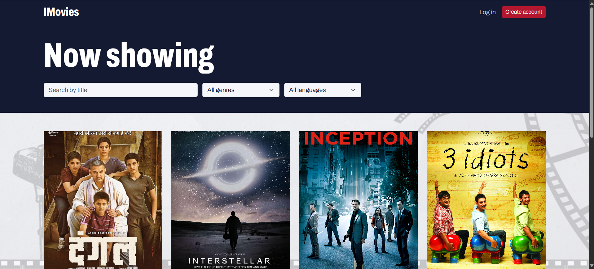
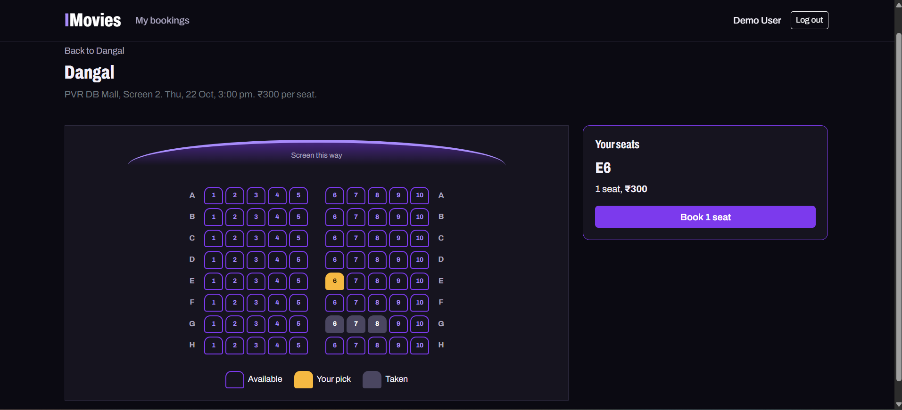
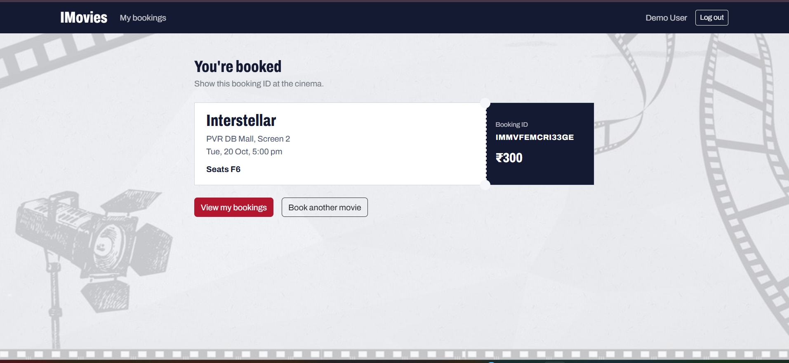

# IMovies

IMovies is a movie ticket booking web app. Visitors browse movies and showtimes, pick seats on an interactive seat map, and book tickets. Admins manage movies, shows and bookings.

It is a three-tier **MERN** application: a React single-page app talks to an Express REST API, which stores data in MongoDB. Login uses JSON Web Tokens (JWT).

## Screenshots

**Home: browse movies, search and filter by genre and language**



**Seat selection: live availability and running total**



**Booking confirmation: the ticket with reference and amount**



## Features

**Users**
- Register and log in (passwords hashed with bcrypt, sessions with JWT)
- Browse movies with search and genre and language filters
- Movie details with upcoming showtimes grouped by day
- Interactive seat map with live availability (refreshes every 5 seconds)
- Book tickets with instant confirmation and total price
- View booking history and cancel a booking, which releases the seats

**Admins**
- Add, edit and delete movies
- Schedule shows with theatre, price and seat-grid size
- View all bookings

**Platform**
- Role-based access control (guest, user, admin) on both client and server
- Double-booking prevention through atomic seat reservation
- Input validation and consistent JSON error responses
- Responsive, keyboard-friendly UI

## Tech stack

| Layer | Technology |
|---|---|
| Client | React, Vite, React Router, Bootstrap, Axios |
| Server | Node.js, Express.js |
| Database | MongoDB with Mongoose |
| Auth | JWT, bcrypt |

## Project structure

```
server/   Express API: config, models, controllers, routes, middleware, seed and smoke test
client/   React app: pages, components, auth context and API service
```

The server follows the MVC pattern: routes map URLs to controllers, controllers apply the logic using Mongoose models, and the JSON response is rendered by the React client.

## How to run the project

The project has two parts that run side by side: the **server** (API on port 5000) and the **client** (React app on port 5173). Both need MongoDB.

### 1. Prerequisites

| Tool | Version | Used for |
|---|---|---|
| Node.js (with npm) | 18 or newer (20 LTS recommended) | Running the server and the client |
| MongoDB | Local Community Server, or a free MongoDB Atlas cluster | The database |
| Git | Any recent version | Getting the code |

```bash
node -v
npm -v
```

### 2. Get the project

```bash
git clone https://github.com/Krati1609/imovies
cd imovies
```

### 3. Prepare MongoDB

Pick one option.

- **Local MongoDB:** install MongoDB Community Server from mongodb.com/try/download/community and start it (on Windows it runs as a service; otherwise run `mongod`). The default address is `mongodb://127.0.0.1:27017`.
- **MongoDB Atlas:** create a free cluster at mongodb.com/atlas. Under Database Access, create a database user. Under Network Access, allow your IP. Then click Connect, then Drivers, and copy the connection string.

### 4. Set up and start the server

Open a terminal in the project folder.

**4.1 Install dependencies**

```bash
cd server
npm install
```

**4.2 Create the settings file**

```bash
# macOS / Linux
cp .env.example .env

# Windows (Command Prompt)
copy .env.example .env
```

Open `server/.env` and fill it in:

| Variable | What to put |
|---|---|
| `PORT` | `5000` |
| `MONGO_URI` | Local: `mongodb://127.0.0.1:27017/imovies`. Atlas: your connection string, ending with the database name `/imovies` |
| `JWT_SECRET` | Any long random string. Never share it or commit it |
| `JWT_EXPIRES_IN` | `7d` |
| `CLIENT_ORIGIN` | `http://localhost:5173` |

**4.3 Fill the database with sample data**

```bash
npm run seed
```

This creates the demo accounts, sample movies and shows:

| Role | Email | Password |
|---|---|---|
| Admin | `admin@imovies.com` | `admin123` |
| User | `user@imovies.com` | `user123` |

**4.4 Start the API**

```bash
npm run dev
```

The server connects to MongoDB first and only then starts listening on `http://localhost:5000`. Leave this terminal open.

**4.5 Optional: run the end-to-end check**

In a second terminal, with the server running:

```bash
cd server
npm run smoke
```

This calls the API from start to finish (register, login, browse, book, cancel and the admin routes) and reports whether each check passed.

### 5. Set up and start the client

Open a **new** terminal in the project folder. The server must already be running.

```bash
cd client
npm install
npm run dev
```

Vite starts the app on `http://localhost:5173` and forwards every `/api` request to the server on port 5000.

### 6. Open the app

Go to **http://localhost:5173** in your browser. You should see the movie grid on the home page.

### 7. Check that everything works

| # | Do this | Expected result |
|---|---|---|
| 1 | Search by title and use the genre and language filters | The grid narrows as you filter |
| 2 | Open a movie | Details and upcoming showtimes, grouped by day |
| 3 | Pick a showtime while logged out | The seat map opens, and the button reads "Log in to book" |
| 4 | Log in as `user@imovies.com` / `user123` | You return to the same show |
| 5 | Select two or three seats and confirm | A ticket confirmation with a booking reference and total |
| 6 | Open **My Bookings** | The booking is listed as `confirmed` |
| 7 | Cancel that booking | Status becomes `cancelled` and the seats are free again |
| 8 | Log in as `admin@imovies.com` / `admin123` and open `/admin` | Tabs for movies, shows and bookings |
| 9 | Add a movie, then schedule a show for it | Both appear on the user side |

To see double-booking prevention, open the same show in two browsers, select the same seat in both and confirm in both. One booking succeeds and the other is rejected with "seats no longer available".

### 8. Production build (optional)

```bash
cd client
npm run build
```

The optimised files are written to `client/dist`. If the API is hosted somewhere other than `localhost:5000`, create `client/.env` with `VITE_API_URL=https://your-server/api` before building. In that case `CLIENT_ORIGIN` on the server must be the address of the deployed client.

### Command reference

| Where | Command | Purpose |
|---|---|---|
| `server/` | `npm install` | Install server dependencies |
| `server/` | `npm run seed` | Create admin, sample movies and shows |
| `server/` | `npm run dev` | Start the API on port 5000 |
| `server/` | `npm run smoke` | End-to-end API check |
| `client/` | `npm install` | Install client dependencies |
| `client/` | `npm run dev` | Start the React app on port 5173 |
| `client/` | `npm run build` | Production build into `client/dist` |

## API overview

| Method | Endpoint | Access | Purpose |
|---|---|---|---|
| POST | `/api/auth/register` | Public | Create account |
| POST | `/api/auth/login` | Public | Login, returns JWT |
| GET | `/api/auth/me` | User | Current user profile |
| GET | `/api/movies` | Public | List and search movies |
| GET | `/api/movies/:id` | Public | Movie details |
| POST/PUT/DELETE | `/api/movies[/:id]` | Admin | Manage movies |
| GET | `/api/movies/:id/shows` | Public | Upcoming showtimes, with seats left |
| GET | `/api/shows/:id` | Public | Show details and seat map |
| POST | `/api/shows` | Admin | Create a show |
| DELETE | `/api/shows/:id` | Admin | Delete a show (blocked if it has bookings) |
| POST | `/api/bookings` | User | Book seats |
| GET | `/api/bookings/mine` | User | My bookings |
| PATCH | `/api/bookings/:id/cancel` | User | Cancel a booking |
| GET | `/api/bookings` | Admin | All bookings |

## Troubleshooting

| Problem | Likely cause and fix |
|---|---|
| Server stops at start-up with a message about `MONGO_URI` | `server/.env` is missing, in the wrong folder, or `MONGO_URI` is empty. The file must be at `server/.env` |
| Server exits with a database connection error | Local: MongoDB is not running. Atlas: your IP is not allowed under Network Access, or the username or password is wrong. Special characters in an Atlas password must be URL-encoded |
| Home page is empty | The database has no data yet. Run `npm run seed` in `server/` |
| The client shows a network error | The server is not running, or it is not on port 5000. Start the server first |
| Port 5000 is already in use | Change `PORT` in `server/.env` and update the proxy target in `client/vite.config.js` to the same port. On some macOS versions, system services use port 5000 |
| A CORS error appears (only when using `VITE_API_URL`) | `CLIENT_ORIGIN` in `server/.env` must exactly match the address the client is served from |
| A change to `.env` has no effect | Stop and restart the server (and the client, for `client/.env`) |
| Cannot delete a movie | The movie still has shows. Delete its shows first |
| Cannot log in as the demo users | The seed has not been run against this database. Run `npm run seed` and check that `MONGO_URI` points to the intended database |

## Demo

Demo video: `<paste your video link here>`