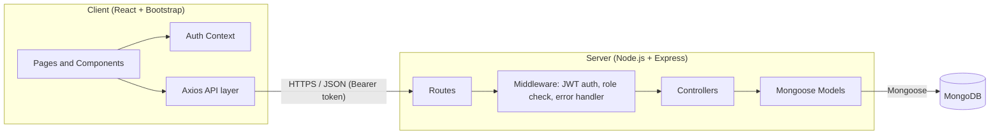
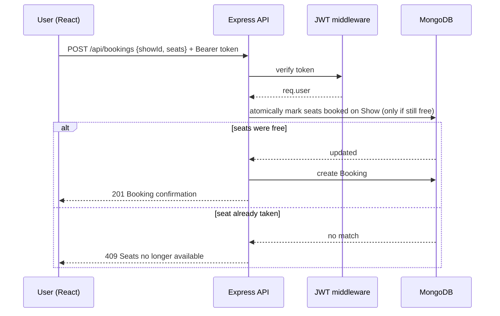

# Technical Architecture

IMovies is a three-tier **MERN** application: a React single-page app talks to an Express REST API, which stores data in MongoDB. Authentication uses JSON Web Tokens (JWT).

## Layers

| Layer | Technology | Responsibility |
|---|---|---|
| Presentation | React.js, React Router, Bootstrap | Pages, seat-selection UI, forms, route guards |
| API | Node.js, Express.js | REST endpoints, validation, business rules |
| Auth | JWT, bcrypt | Stateless login, password hashing, role-based access |
| Data | MongoDB, Mongoose | Persistence, schemas, indexes |

## Key design decisions

1. **Stateless auth.** The server issues a JWT on login. The client sends it in the `Authorization: Bearer <token>` header. No server-side sessions.
2. **Real-time seat availability.** Each `Show` stores its booked seats. Booking uses an atomic conditional update (`updateOne` with a filter that the seats are not already booked), so two users cannot book the same seat. The seat map is re-fetched on a short interval, so users see availability change without a page reload.
3. **Async everywhere.** All I/O uses `async/await` with a shared error-handling wrapper.
4. **Separation of concerns.** The server follows MVC (see `06-mvc-pattern.md`). The client keeps API calls in one service layer, separate from UI components.

## Request lifecycle (example: book seats)

