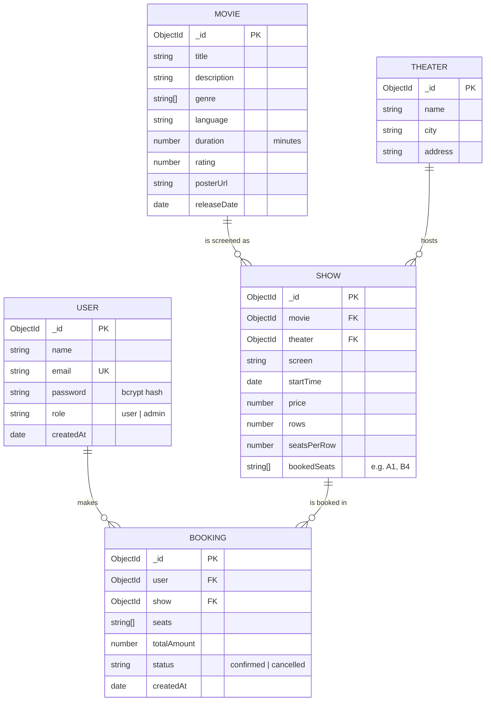

# ER Diagram

MongoDB is document-based, but the data still has clear relationships. These are modelled with ObjectId references.

## Relationships

| Relationship | Type | Notes |
|---|---|---|
| User to Booking | one-to-many | A user can have many bookings |
| Movie to Show | one-to-many | One movie has many showtimes |
| Theater to Show | one-to-many | One theater hosts many shows |
| Show to Booking | one-to-many | Many bookings share a show, each with different seats |

## Notes

- `Show.bookedSeats` is the source of truth for availability. Cancelling a booking removes its seats from this array.
- `email` has a unique index, so duplicate accounts are rejected by the database too.
- Seat labels are built from the grid: row letter plus seat number (A1, A2 ... B1 ...).
