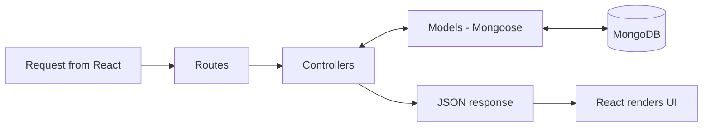

# MVC Pattern

The Express backend is organised as Model, View and Controller. In a REST API the "View" is the JSON response, and the React app renders it.

| MVC part | Folder | Role in IMovies |
|---|---|---|
| **Model** | `server/models/` | Mongoose schemas: `User`, `Movie`, `Show`, `Booking` |
| **View** | JSON responses, rendered by `client/src/` | The API returns JSON, and React components present it |
| **Controller** | `server/controllers/` | Business logic: `authController`, `movieController`, `showController`, `bookingController` |
| Routes | `server/routes/` | Map URLs to controller functions and attach middleware |
| Middleware | `server/middleware/` | `protect`, `adminOnly`, error handler |

## Why MVC

- **Maintainability.** Each file has one job, so bugs are easier to find.
- **Testability.** Controllers can be tested without the UI.
- **Teamwork and growth.** New features (for example, payments) add a model, controller and route without touching existing code.
